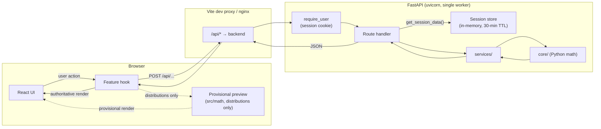
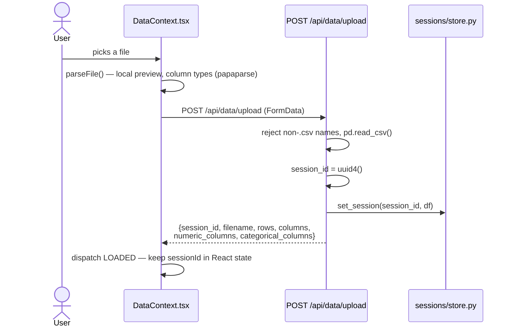
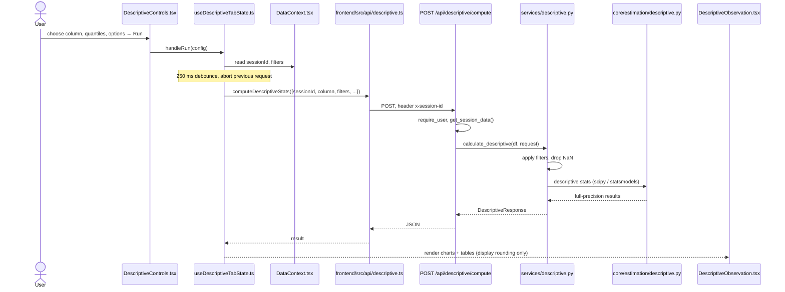
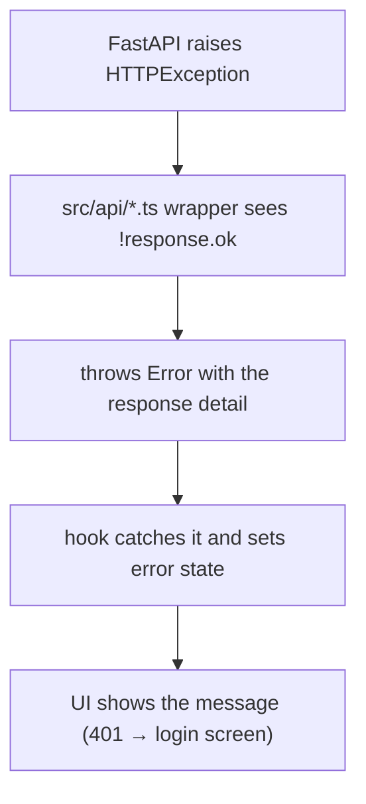

# Frontend ↔ Backend Interaction

How `frontend/` and `backend/` communicate — from a user action in the browser to Python computation and back.

---

## 1. The Big Picture



How `/api` reaches the backend depends on how you run the app:

| Mode | Frontend served by | `/api` forwarded by | Backend reachable at |
|---|---|---|---|
| `npm run dev` / separate terminals | Vite (:5173) | Vite proxy → `VITE_PROXY_TARGET` or `http://localhost:8000` | :8000 |
| `docker-compose.dev.yml` | Vite in a container (:5173) | Vite proxy → `http://backend:8000` | host :8097 |
| `docker-compose.yml` | nginx (:8080, `WEB_PORT`) | nginx → `BACKEND_URL` (default `http://backend:8000`) | not published |

From React's point of view it always talks to its own origin. The CORS policy in `backend/main.py` allows only `http://localhost:5173` (with credentials) for the case where the browser calls the backend directly; the proxied setups are same-origin.

---

## 2. Sign-in

Every `/api` route except `/api/health` and `/api/auth/*` (other than `/api/auth/me`) requires a signed session cookie (`thotsakan_session`, HttpOnly). The browser obtains it by signing in with Google; the backend verifies the Google ID token and the `@cmkl.ac.th` domain. A `401` from any data call sends the UI back to the login screen. Setup and troubleshooting: [`AUTH.md`](AUTH.md).

---

## 3. Sessions: how the backend knows whose data it has

A **dataset session ID** (UUID) ties the browser to its uploaded dataset. It is separate from the login cookie and is not yet tied to the signed-in user.

### Upload flow



Every later data call sends the ID in the **`x-session-id` header**. Descriptive, inference and hypothesis requests also carry a `session_id` body field for schema compatibility; the backend reads the header.

`backend/api/deps.py` resolves the header to a DataFrame:

```python
async def get_session_data(x_session_id: Annotated[str | None, Header()] = None) -> pd.DataFrame:
    if not x_session_id:
        raise HTTPException(400, "Missing x-session-id header")
    data = get_session(x_session_id)
    if data is None:
        raise HTTPException(404, "Session expired or not found. Please upload the dataset again.")
    return data
```

Routes inject it with `df: pd.DataFrame = Depends(get_session_data)`.

### Session lifetime

Stored in a plain Python dict in `backend/sessions/store.py`:
- TTL: **30 minutes** from last access
- Cleanup: a background loop started in `main.py` evicts expired entries every **5 minutes**
- No persistence — a server restart clears all sessions; extra uvicorn workers would not share them
- Dev compose only: when `UPLOAD_DUMP_DIR` is set, a copy of each upload is written to `dev-playground/uploads/<session-id>.csv`

---

## 4. The API Endpoints

| Endpoint | Method | Needs sign-in | Needs `x-session-id` | What it does |
|----------|--------|:---:|:---:|--------------|
| `/api/health` | GET | — | — | Liveness check → `{"status": "ok"}` |
| `/api/auth/config` | GET | — | — | Client ID, allowed domain, whether auth is enabled |
| `/api/auth/google` | POST | — | — | Verify a Google ID token, set the session cookie |
| `/api/auth/me` | GET | ✓ (401 when signed out) | — | Current user from the cookie |
| `/api/auth/logout` | POST | — | — | Clear the session cookie |
| `/api/data/upload` | POST | ✓ | — | Upload a CSV, get a dataset `session_id` |
| `/api/probability/compute` | POST | ✓ | — | One of 12 distributions: PMF/PDF, CDF, query, moments |
| `/api/probability/normal-pdf` | POST | ✓ | — | Normal PDF + CI shading data (kept; no current UI) |
| `/api/descriptive/compute` | POST | ✓ | ✓ | Descriptive statistics + histogram + box plot data |
| `/api/inference/estimators` | POST | ✓ | ✓ | Available estimators for a column |
| `/api/inference/ci` | POST | ✓ | ✓ | Confidence intervals |
| `/api/inference/pi` | POST | ✓ | ✓ | Prediction intervals |
| `/api/inference/regions` | POST | ✓ | ✓ | Confidence regions |
| `/api/graphical/compute` | POST | ✓ | ✓ | Histogram / empirical PMF / ECDF and overlays |
| `/api/hypothesis/test` | POST | ✓ | ✓ | Run one of the 4 tests; α, critical values, rejection region, verdict |

---

## 5. Worked Example: Descriptive Statistics



---

## 6. How each tab calls the backend

| Tab | Trigger | Debounce | Cancels stale requests |
|---|---|---|---|
| Common Distributions | Every parameter change; provisional preview renders first | 250 ms | `AbortController` |
| Descriptive | Run / Reset in the controls | 250 ms | `AbortController` |
| Statistical Inference | Run button | — | — |
| Graphical Analysis | Display toggles live; estimator / bootstrap overlays via Run | 250 ms (live path) | `AbortController` |
| Hypothesis Testing | Run button, then live re-runs after the first run | 250 ms (re-runs) | — |

The provisional preview (`frontend/src/math/`) exists **only** for Common Distributions. It is marked `provisional: true` and silently replaced by the backend result.

---

## 7. Filter System

Filters chosen in the Data tab live in `DataContext`:

```typescript
filters: Record<string, string[]>
// e.g. { "Gender": ["Female"], "Department": ["Engineering", "Science"] }
```

Descriptive, inference, graphical and hypothesis requests include `filters` in the body. The backend keeps only rows whose column value (as a string) is in the allowed list — `apply_filters()` in `api/deps.py` for inference, graphical and hypothesis; an equivalent loop in `services/descriptive.py` for descriptive.

---

## 8. Error Handling



| Status | When |
|---|---|
| `400` | Missing `x-session-id`, unknown column, invalid parameters (services raise `ValueError`), non-CSV upload |
| `401` | Not signed in, expired or invalid session cookie, wrong domain |
| `404` | Dataset session not found or expired |
| `500` | Unexpected exception (descriptive route maps these explicitly) |

There is no shared client module: each `src/api/*.ts` file does its own `fetch` and error handling.

---

## 9. File Map

| What you want to understand | File(s) to read |
|-----------------------------|-----------------|
| Dev proxy | `frontend/vite.config.ts` |
| Production proxy | `frontend/nginx.conf.template`, `docker-compose.yml` |
| Fetch calls + TypeScript types | `frontend/src/api/` |
| How a tab orchestrates API calls | `frontend/src/hooks/useDistribution.ts`, `frontend/src/features/**/use*TabState.ts` |
| Session ID, filters, precision | `frontend/src/context/DataContext.tsx` |
| Sign-in state, 401 handling | `frontend/src/context/AuthContext.tsx` |
| Route definitions and mounting | `backend/api/routes/`, `backend/main.py` |
| Request/response shapes | `backend/api/schemas/` |
| Auth gate, session lookup, filters | `backend/api/deps.py` |
| In-memory session store + TTL | `backend/sessions/store.py` |
| Pure math (professor verifies) | `backend/core/` |

Every folder's responsibilities: [`folder_duties.md`](folder_duties.md). Open issues affecting this flow: [`known_issues.md`](known_issues.md).
