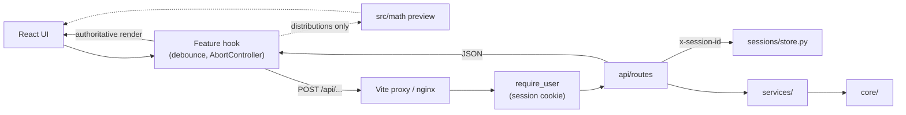

# Architecture

How the React frontend and the FastAPI backend fit together: layers, folders, requests, sessions and endpoints. Checked against the code on branch `dev` (2026-10-13).

## 1. Stack

| Part | Tech |
|---|---|
| `frontend/` | React 19, TypeScript 5.9, Vite 7, Tailwind CSS 4; Plotly (`react-plotly.js` + `plotly.js-basic-dist-min`, lazy-loaded); papaparse, jsPDF, react-error-boundary; Vitest 4 + jsdom |
| `backend/` | FastAPI, uvicorn (single worker), numpy, pandas, scipy, statsmodels, pingouin; google-auth + PyJWT for sign-in; pytest + httpx in `requirements-dev.txt` |
| Reference | The professor's Gradio app (`ThotsakanStatistics/`, branch `main`) and the Reflex prototype (`Try_reflex/`): read-only, git-ignored, local only |

KaTeX and MathLive are **not** installed. Only leftover type declarations remain (see [roadmap.md](roadmap.md#known-issues)).

## 2. Zero frontend math

The Python backend does all statistical computation. The frontend sends requests and renders the results. The professor verifies correctness by reading `backend/core/`.

There is one exception. `frontend/src/math/localDistributions.ts` draws a provisional preview while a Common Distributions slider is being dragged. Its output is marked `provisional: true` and is always replaced by the backend result. No other tab uses it.

## 3. Request flow



1. The user moves a control or presses **Run** (see §8 for which tabs do which).
2. After the debounce, the previous in-flight request is aborted and a new one is sent. The UI shows a loading state.
3. The route validates the request with Pydantic and calls the service. The service calls `core/`.
4. `core/` returns full-precision results. Rounding happens only for display in React.

### Run modes

| Mode | Command | Frontend | `/api` forwarded by | Backend |
|---|---|---|---|---|
| Local | `npm run dev` (root) | Vite :5173 | Vite proxy → `VITE_PROXY_TARGET` or `localhost:8000` | :8000 |
| Docker dev | `docker compose -f docker-compose.dev.yml up` | Vite :5173 | Vite proxy → `backend:8000` | host :8097 |
| Docker prod-style | `docker compose up --build` | nginx :8080 (`WEB_PORT`) | nginx → `BACKEND_URL` | not published |

The browser always talks to its own origin. CORS in `backend/main.py` allows only `http://localhost:5173`, for the case where the browser calls the backend directly. FastAPI never serves the frontend.

## 4. Backend layers

```
api/routes/  (+ api/deps, api/schemas)
  └── services/   (+ api/schemas for response models)
        └── core/  ← all math; imports nothing from the project
```

- `core/` must not import `services`, `api` or `sessions`. It keeps full precision.
- Files copied from the professor's app stay **byte-identical**: `core/hypothesis_testing/__init__.py` and `core/estimation/graphical_analysis.py`. New behaviour goes in sibling modules.
- `services/` must not import numpy, scipy or statsmodels. A service validates input, calls `core/` and maps the result to a schema.
- Routes stay thin (`api/routes/inference.py` currently breaks this rule; see the roadmap).
- Estimator choices are explicit, and bootstrap procedures take a seed.

### `core/`

| Path | Duty |
|---|---|
| `probability/common_distributions/distributions.py`, `normal_pdf.py` | 12 distributions; normal PDF + CI shading *(project addition)* |
| `probability/custom_distributions/`, `approximation/` | Empty stubs |
| `estimation/descriptive.py` | Descriptive measures + `compute_histogram`, `compute_boxplot_data` |
| `estimation/graphical_analysis.py` | Professor's matplotlib plots (byte-identical, not used by the API) |
| `estimation/graphical_json.py` | JSON version for the API: histogram, PMF, ECDF + DKW band, KDE, rug, normal, interval bands *(project addition)* |
| `estimation/inference/` | `ci*.py`, `pi*.py`, `estimators.py`, `estimator_options.py`, `likelihood.py`, `confidence_regions.py` |
| `hypothesis_testing/__init__.py` | Professor's four tests (byte-identical, never edit) |
| `hypothesis_testing/rejection_region.py`, `tables.py` | α, critical values, rejection region; plot-free ANOVA table *(project additions)* |
| `linear_regression/` | Empty, not started |
| `data_stats.py` | Legacy Gradio helper; imports `gradio`, which isn't installed. Unused |

### `services/`, `api/`, `sessions/` and top-level files

| File | Duty |
|---|---|
| `services/auth.py` | Verify Google ID tokens; issue and read session JWTs |
| `services/descriptive.py` | Filters, NaN handling, weights → `core/estimation/descriptive.py` |
| `services/inference.py` | Picks the distribution and estimators; builds CIs, PIs and confidence regions |
| `services/graphical.py` | Graph data via `graphical_json.py`; reuses `services/inference.py` for CI/PI bands |
| `services/hypothesis.py` | Runs the selected test, builds the groups, adds the rejection region |
| `services/probability.py` | Thin wrapper over `core/probability/` |
| `api/routes/*.py` | One router per area (endpoints in §6) |
| `api/schemas/*.py` | Pydantic request/response models |
| `api/deps.py` | `require_user` (auth gate), `get_session_data` (`x-session-id` → DataFrame), `apply_filters` |
| `sessions/store.py` | In-memory dict, 30-min TTL |
| `main.py` | App, CORS, routers (all but auth behind `require_user`), session cleanup loop, `/api/health` |
| `config.py` | Settings from the root `.env`; refuses to start if auth is misconfigured |
| `tests/` | pytest (`testpaths = tests`): core/service tests, `tests/services/`, `tests/api/`; `conftest.py` signs tests in |

## 5. Frontend layout

| Folder | Contents |
|---|---|
| `api/` | One fetch wrapper per area (`descriptive`, `inference`, `graphical`, `hypothesis`, `probability`). Each file builds its own URLs and types and throws a plain `Error`. There is no shared client. |
| `features/` | One folder per tab: `home/`, `data/`, `probability/common/`, `estimation/{descriptive,inference,graphical}/`, `hypothesis/`. Each LabBench tab has `*Controls`, `*Observation`, `*Notebook`, usually a `*Tab.tsx` that exports the three slots, and a `use*TabState.ts` hook |
| `hooks/` | `useDistribution`, `useChartRegistry` (chart export), `useLocalStorageState`, `useResizablePanel`, `useSidebarKeyboard`, `useContainerBreakpoint` (unused) |
| `components/` | `DualInput`, `ControlPrimitives` (`SelectField`, `SwitchField`, `Accordion`, …), `AnalysisStatus`, `ResultToolbar`, `ExportMenu`, `DragHandle`, `CollapsedRail`, `LoginGate` |
| `context/` | `DataContext` (dataset, `sessionId`, column types, filters, precision; does the upload), `AuthContext` (user, sign-in/out, `401` → login) |
| `layout/` | `LabBench`, `LogoBar`, `Header`, `SubHeader`, `Footer` |
| `math/` | Provisional distribution preview only (§2) |
| `utils/` | `parseFile`, `exportCSV`, `exportPNG`, `exportPDF`, `exportFilename` |

Tab state hooks are created in `App.tsx`, so each tab keeps its state when you switch away. UI design (panels, DualInput, theme): [design.md](design.md).

## 6. API endpoints

| Endpoint | Method | Sign-in | `x-session-id` | Purpose |
|---|---|:---:|:---:|---|
| `/api/health` | GET | | | Liveness |
| `/api/auth/config` | GET | | | Client ID, allowed domain, auth enabled |
| `/api/auth/google` | POST | | | Verify Google ID token, set cookie |
| `/api/auth/me` | GET | ✓ | | Current user |
| `/api/auth/logout` | POST | | | Clear cookie |
| `/api/data/upload` | POST | ✓ | | Upload CSV → dataset `session_id` |
| `/api/probability/compute` | POST | ✓ | | 12 distributions: PMF/PDF, CDF, query, moments |
| `/api/probability/normal-pdf` | POST | ✓ | | Normal PDF + CI shading (no UI now) |
| `/api/descriptive/compute` | POST | ✓ | ✓ | Statistics + histogram + box plot data |
| `/api/inference/estimators` | POST | ✓ | ✓ | Valid estimators for a column |
| `/api/inference/ci`, `/pi`, `/regions` | POST | ✓ | ✓ | Confidence / prediction intervals, confidence regions |
| `/api/graphical/compute` | POST | ✓ | ✓ | Histogram / PMF / ECDF and overlays |
| `/api/hypothesis/test` | POST | ✓ | ✓ | One of 4 tests + α, critical values, verdict |

| Status | Meaning |
|---|---|
| `400` | Missing `x-session-id`, unknown column, invalid parameters, non-CSV upload |
| `401` | Not signed in, bad/expired cookie, wrong domain. The UI returns to the login screen |
| `404` | Dataset session expired or not found |
| `500` | Unexpected error |

## 7. Sign-in, sessions and filters

**Sign-in.** Every data route needs the signed HttpOnly cookie `thotsakan_session`, which is issued after a Google ID token from a verified `@cmkl.ac.th` account is checked. Setup: [AUTH.md](AUTH.md).

**Dataset sessions** are a separate thing from the login cookie:

1. The Data tab parses the CSV in the browser (papaparse) for the preview, column types and filter UI. It also POSTs the file to `/api/data/upload`.
2. The backend reads the file with pandas and stores the DataFrame in memory under a UUID. It returns column metadata.
3. `DataContext` keeps the ID and sends it as the `x-session-id` header on every analysis call. Some request bodies also have a `session_id` field, but the backend reads the header.
4. A session expires 30 minutes after it was last used, and expired sessions are cleaned up every 5 minutes. A restart clears all sessions, and extra uvicorn workers wouldn't share them. In the dev compose stack, `UPLOAD_DUMP_DIR` also writes a copy of each upload to `dev-playground/uploads/`.

**Filters** (`Record<string, string[]>` in `DataContext`) are sent with descriptive, inference, graphical and hypothesis requests and applied on the server: by `apply_filters()` in `api/deps.py`, or by an equivalent loop in `services/descriptive.py`.

## 8. How each tab calls the backend

| Tab | Trigger | Debounce | Aborts stale requests |
|---|---|---|---|
| Common Distributions | Every parameter change (provisional preview first) | 250 ms | ✓ |
| Descriptive | Run / Reset | 250 ms | ✓ |
| Statistical Inference | Run | — | — |
| Graphical Analysis | Display toggles update live; estimator/bootstrap overlays use Run | 250 ms (live) | ✓ |
| Hypothesis Testing | Run, then re-runs live on changes | 250 ms (re-runs) | — |

## 9. Testing and CI

- **Backend:** `pytest` in `backend/` (needs `requirements-dev.txt`). API tests run as a signed-in user via `tests/conftest.py`.
- **Frontend:** `npm run test` (Vitest, tests next to the code) and `npm run build` (type check + build).
- **CI** (`.github/workflows/docker.yml`): builds both images, pushes to GHCR on pushes to `dev`, and smoke-tests the compose stack with `AUTH_DISABLED=true`. It does **not** run pytest or Vitest, so run them locally.
- No linter or formatter is configured.
